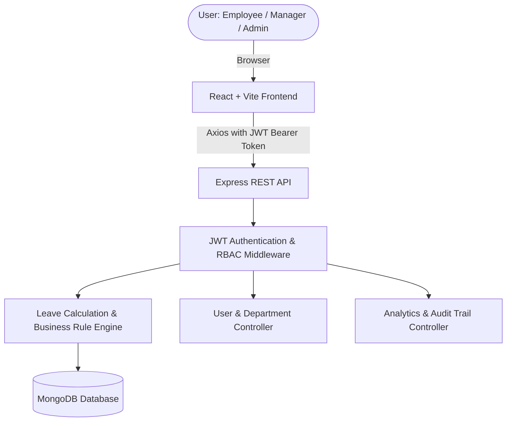

# Leave Management System (LMS) - MERN Stack

A modern, full-stack **Leave Management System (LMS)** designed and implemented for college full-stack project submission. Built with Node.js, Express.js, MongoDB (with Mongoose), and React (Vite) styled using Tailwind CSS, Lucide React icons, and Recharts.

---

## 1. Project Overview & Features

### Core Highlights
- **Role-Based Access Control (RBAC):** Dedicated interfaces and permissions for **Employee**, **Manager**, and **Admin**.
- **Server-Side Business Rule Enforcement:**
  - Automatic workday calculation excluding Saturdays and Sundays.
  - Prevention of past-date applications and overlapping leave schedules.
  - Balance deductions occur **strictly upon manager approval**; balances are never deducted for pending or rejected requests.
  - Atomic restoration of deducted balances if an approved leave is cancelled.
  - Safeguards against self-approval and unauthorized cross-employee cancellations.
- **Interactive Leave Calendar:** Visual month-by-month calendar with status color codes (Green = Approved, Amber = Pending).
- **Executive Analytics & Data Visualizations:** Recharts-powered monthly trend bar charts, leave type distribution donut charts, and departmental workload summaries.
- **Zero-Setup Database Architecture:** Seamlessly connects to local MongoDB or MongoDB Atlas; if neither is available, it automatically boots an embedded in-memory MongoDB (`mongodb-memory-server`) with realistic demonstration seed data.
- **1-Click Demo Logins:** Login screen features quick-fill shortcuts for Admin, Manager, and Employee to ensure rapid presentation during viva.
- **Export to CSV:** Admin can export leave records with one click.

---

## 2. Technology Stack

| Layer | Technologies |
|---|---|
| **Frontend** | React 18, Vite 5, Tailwind CSS, React Router DOM 6, Lucide React, Axios, React Hot Toast, Recharts, React Hook Form |
| **Backend** | Node.js, Express.js, JSON Web Tokens (JWT), bcryptjs, Morgan |
| **Database** | MongoDB with Mongoose ODM (with automatic in-memory fallback for zero-config evaluation) |

---

## 3. Demo Credentials for Evaluation / Viva

| Role | Email | Password | Assigned Scope / Permissions |
|---|---|---|---|
| **Admin** | `admin@company.com` | `admin123` | Head of Operations. Can manage employees, assign roles/managers, edit leave quotas, inspect company-wide leaves, and view audit trail. |
| **Manager (Engineering)** | `manager.eng@company.com` | `manager123` | Director of Engineering. Approves/rejects leaves for Alice Johnson & Bob Smith; views team calendar & attendance. |
| **Manager (HR)** | `manager.hr@company.com` | `manager123` | HR Lead. Approves/rejects leaves for Charlie Davis & Diana Prince. |
| **Employee** | `alice@company.com` | `employee123` | Senior Frontend Engineer. Applies for leaves, checks remaining balances, views personal calendar, and cancels requests. |
| **Employee** | `bob@company.com` | `employee123` | Backend Developer under Engineering team. |

*(All roles feature **1-Click Quick Demo Login** buttons directly on the `/login` screen!)*

---

## 4. System Architecture & Workflows



---

## 5. Leave Policy & Business Rules Matrix

1. **Working Days Calculation:** Automatically loops across the selected dates and counts only Monday through Friday (`getDay() !== 0 && getDay() !== 6`).
2. **Weekend Only Rejection:** Selecting Saturday and Sunday returns an explicit validation error: *"Leave must cover at least one working day."*
3. **Overlapping Requests Guard:** Server verifies if the applicant already has a `pending` or `approved` leave overlapping with the requested date window.
4. **No Balance Deduction upon Application:** The application starts in `pending` status. Balances are touched **only** upon review.
5. **Approval Deduction:** When manager approves, the required days are atomically subtracted from employee's leave balance.
6. **Cancellation Balance Refund:** If an employee or admin cancels an approved leave, the deducted days are automatically refunded back to the user's quota.
7. **Anti Self-Approval:** A manager cannot approve or reject their own leave requests.
8. **Manager Isolation:** Managers can only view and act upon requests belonging to employees assigned directly to them.

---

## 6. Project Setup & Execution Instructions

### Prerequisites
- Node.js (v18 or higher recommended)
- npm (v9 or higher)

### Step 1: Install & Start Backend Server
```bash
# Navigate to backend directory
cd backend

# Install dependencies
npm install

# Start development server
npm start
```
*The backend server will launch on `http://localhost:5000`.*
*(If MongoDB is not running on your machine, it will automatically spin up an embedded in-memory MongoDB and seed the demo data!)*

### Step 2: Install & Start Frontend Application
Open a second terminal window:
```bash
# Navigate to frontend directory
cd frontend

# Install dependencies
npm install

# Start Vite development server
npm run dev
```
*The client application will open on `http://localhost:5173`.*

---

## 7. REST API Endpoints Reference

### Authentication (`/api/auth`)
- `POST /api/auth/register` - Register a new employee account
- `POST /api/auth/login` - Authenticate user and retrieve JWT token
- `GET /api/auth/me` - Get current logged-in user details & live balances
- `POST /api/auth/logout` - Invalidate session / logout confirmation
- `PUT /api/auth/profile` - Update profile information
- `PUT /api/auth/change-password` - Change user password

### Leaves Management (`/api/leaves`)
- `POST /api/leaves` & `POST /api/leaves/apply` - Submit new leave request (with optional Multer document upload)
- `GET /api/leaves` - Role-aware query (all for admin, team for manager, my for employee)
- `GET /api/leaves/my` & `GET /api/leaves/my-leaves` - Get applicant's own leaves with filters & pagination
- `GET /api/leaves/team-leaves` - Manager view of assigned employee requests
- `GET /api/leaves/:id` - Single leave details
- `GET /api/leaves/:id/document` - Secure authenticated download of supporting document
- `PATCH /api/leaves/:id/approve` - Approve request and atomically deduct leave balance
- `PATCH /api/leaves/:id/reject` - Reject request with mandatory explanation comment
- `PATCH /api/leaves/:id/cancel` & `PUT /api/leaves/:id/cancel` - Cancel request and restore balance if previously approved
- `PUT /api/leaves/:id/review` - Review handler supporting approve/reject actions
- `GET /api/leaves/all` - Admin master list of all company leaves
- `GET /api/leaves/calendar` - Events for month calendar view
- `GET /api/leaves/stats` & `GET /api/dashboard/stats` - Role-customized KPI counts
- `GET /api/leave-balances` - Detailed balance sheets with quotas, used, and pending days

### Employees & User Administration (`/api/employees`, `/api/users`, `/api/departments`)
- `GET /api/employees` & `GET /api/users` - Employee directory with search, filter, and pagination
- `GET /api/employees/:id` & `GET /api/users/:id` - Single employee profile & leave history
- `POST /api/employees` & `POST /api/users` - Admin create employee or manager
- `PUT /api/employees/:id` & `PUT /api/users/:id` - Admin update employee details, manager, role, and quotas
- `PATCH /api/employees/:id/status` & `PUT /api/users/:id/status` - Activate or deactivate employee account
- `DELETE /api/employees/:id` & `DELETE /api/users/:id` - Delete employee record
- `GET /api/users/managers` - List all active managers for assignment
- `GET /api/users/team-members` - Manager view of assigned team members
- `GET /api/departments` - List company departments
- `POST /api/departments` - Admin create department

### Leave Types Policy (`/api/leave-types`)
- `GET /api/leave-types` - List active leave types and annual policies
- `POST /api/leave-types` - Admin create new leave type
- `PUT /api/leave-types/:id` - Admin configure annual quota & active status
- `DELETE /api/leave-types/:id` - Admin remove leave type
- `POST /api/leave-types/reset-balances` - Reset annual balances across employees

### Company Holidays (`/api/holidays`)
- `GET /api/holidays` - List company holidays (automatically excluded from leave working days)
- `POST /api/holidays` - Admin schedule new official company holiday
- `DELETE /api/holidays/:id` - Admin remove holiday

### Reports & Audits (`/api/reports`)
- `GET /api/reports/analytics` & `GET /api/reports/leave-summary` - Recharts analytics (monthly trends, category distribution, departments)
- `GET /api/reports/audit-logs` - System audit trail

---

## 8. Verification & Automated Testing

A complete automated test suite is provided in `backend/test-suite.js`.

To run the full suite:
```bash
cd backend
node test-suite.js
```

The automated suite tests 19 core business rules and workflows:
1. Seed dataset verification (Admin, Manager, Employees, Holidays, LeaveBalances).
2. Bcrypt password validation and JWT token issuance.
3. Weekend exclusion (Saturday & Sunday calculate to 0 working days).
4. Monday-to-Friday 5-day duration calculation.
5. Automatic exclusion of configured company holidays from leave day counts.
6. Past date rejection.
7. Balance non-deduction while status is pending.
8. Overlapping leave schedule detection and rejection.
9. Manager approval and atomic balance deduction.
10. Leave cancellation and atomic balance refund.

---

## 9. License & Submission
Developed for academic full-stack project submission. All rights reserved.
